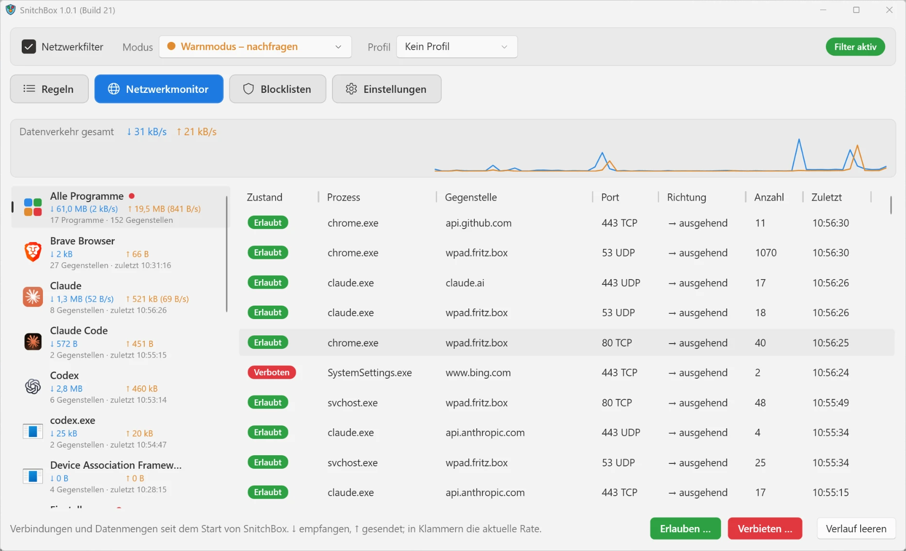

# SnitchBox for Windows

**English** · [Deutsch](README.de.md)

An application firewall for Windows 11 x64 in the spirit of Little Snitch (macOS) – WPF/.NET 10, no installation required.
It shows which program wants to connect where, holds the connection and lets you allow or deny it.

**Download:** see [Releases](../../releases) – `SnitchBox-Setup.exe` (installer, sets up the .NET Desktop Runtime 10 if needed)
or `SnitchBox.exe` (single file, requires the .NET Desktop Runtime 10). Both need administrator rights and are not signed
(Windows SmartScreen: “More info” → “Run anyway”).

## Features

- Alert window for every new connection: program (with its digital signature checked by Windows: valid, invalid or unsigned), host name, port; lifetime (Once … Forever) and scope (any connection, port, domain, host)
- Modes: Alert Mode, Silent Mode “allow all” / “deny all”; network filter on/off (with a warning before turning it off or quitting)
- Windows services in svchost.exe shown and ruled individually (e.g. deny telemetry “DiagTrack”, keep Windows Update)
- Windows programs with understandable names and icons: “Windows service host” instead of svchost.exe, “Start menu”, “Windows Search”, “Telemetry: compatibility” (CompatTelRunner.exe), “Tips and suggestions” and many more; programs without an icon of their own get one by type (system, shell, search, settings, security, telemetry, tips/ads, installation, command line)
- Known apps at a glance: Claude, Claude Code, ChatGPT, Google Chrome, Brave, Firefox, Microsoft Edge, Visual Studio Code, Visual Studio, NordVPN, Microsoft Office (with OneDrive, the new Outlook and Teams), Adobe Creative Cloud and Adobe Acrobat are shown with their name and icon – including their updaters (“Google Updater” instead of “updater.exe”) and helper programs, marked with a small badge
- Per-program rules: allow/deny, outgoing/incoming, hosts, domains, address ranges, local network, system DNS servers, ports, TCP/UDP, priority, lifetime, profiles
- Profiles switch automatically per network (e.g. “Home” on your router, “On the go” everywhere else); a profile chosen by hand lasts until the next network change
- Denying takes effect immediately: established connections that a rule change newly denies are cut (IPv4 and IPv6)
- Network Monitor: every connection attempt per program and remote, data volume and current rate per program, data volume per remote (rate in a tooltip), total data rate, create a rule straight from a row
- Subscribe to blocklists (.lsrules, hosts files, domain lists) with daily updates; import/export of .lsrules
- Tray icon; starts at sign-in via Task Scheduler (no UAC prompt)
- While nothing is being filtered (network filter off or driver not running), the tray and the taskbar show a red shield with a white cross
- User interface in 12 languages

How it works: the WinDivert 2.2.2 driver (third_party/windivert, unmodified from the official release, LGPLv3) routes TCP connection setup
and UDP through the program. Decisions are made by the platform-independent core (src/SnitchBox.Core).
The filter only works while SnitchBox is running; when the program exits, traffic flows unfiltered.

## Building and placement

- Windows: `powershell -ExecutionPolicy Bypass -File build-windows.ps1` · Mac: `./build-windows.sh` (also redraws the icon).
  Both increment BUILD_NUMBER and run the core tests first (`dotnet run --project tests/SnitchBox.Tests`).
- `dist/SnitchBox.exe` – a single file, requires the “.NET Desktop Runtime” 10 or later (if it is missing, Windows offers the download). Recommended.
  Together with `dist/SnitchBoxStart.exe`, the native starter (built with the C++ compiler of Visual Studio, workload “Desktop development with C++”).
- `dist/SnitchBox-Standalone/` – runs without a .NET installation; the WPF libraries sit next to the .exe.
- `dist/SnitchBox-Setup.exe` – small installer (about 1 MB, built by build-windows.ps1 only) for other PCs, see below.

## Installer for other PCs

`SnitchBox-Setup.exe` runs on any Windows 10/11 x64 without preparation (.NET Framework 4.x is built in) and asks for
administrator rights. It
- installs SnitchBox to `C:\Program Files\SnitchBox` (writable by administrators only),
- downloads the .NET Desktop Runtime 10 from Microsoft if needed (`aka.ms/dotnet/10.0/…`, latest patch) and installs it silently – only if
  the file carries a valid Microsoft signature; without internet access it offers the download page,
- optionally creates shortcuts in the Start menu and on the desktop, sets up autostart and starts SnitchBox,
- closes a running SnitchBox for the update and starts it again afterwards,
- registers itself under “Apps”; from there (or with the “Uninstall” button) SnitchBox is removed again, optionally including its rules.

Unattended (e.g. software distribution): `SnitchBox-Setup.exe /quiet` installs with a Start menu shortcut and autostart,
`SnitchBox-Setup.exe /uninstall /quiet` removes SnitchBox (rules are kept); log in `%TEMP%\SnitchBox-Setup.log`, exit code 0 = success.
If the installer runs as SYSTEM, autostart applies to every administrator account.
The installer is not signed: when downloaded from the internet, Windows SmartScreen warns on first start (“More info” → “Run anyway”).
- Neither version extracts anything to %TEMP% on startup. (Up to Build 12 the standalone version did; anything under `%TEMP%\.net\SnitchBox` can be deleted.)
- Location: preferably `C:\Program Files\SnitchBox`. SnitchBox runs with administrator rights; if the .exe sits in a folder that
  ordinary programs can write to as well (e.g. Documents, Downloads, `C:\Tools`), they could replace it. SnitchBox warns about this when
  setting up autostart, once per build at startup (if an existing autostart launches such a file) and in the settings.
  After moving it, turn autostart off and on again so that it starts the new file.

## Languages, start parameters and data

Languages: German, English, French, Spanish, Italian, Portuguese (Brazil), Polish, Turkish, Russian, Japanese,
Chinese (Simplified), Korean – the default is the Windows display language, changeable under Settings → Language (takes effect immediately).
German and English live in the code (`Loc.T`/`Loc.F`), the others in `src/SnitchBox.Core/Lang/<code>.json` (English text → translation).
New or changed texts: `python scripts/extract_strings.py` regenerates the template `Lang/_source.json` and lists missing translations;
the build scripts abort as long as any language is incomplete.

Start parameters: `--appearance light|dark`, `--lang de|en|fr|es|it|pt|pl|tr|ru|ja|zh|ko`, `--tray`, `--demo` (made-up connections without the driver, data kept separately in `%ProgramData%\SnitchBox\demo`).
Data and log: `%ProgramData%\SnitchBox\` (config.json, log.txt, blocklists\, driver\). The folder is writable by administrators only;
SnitchBox makes sure of this at every start: foreign entries (created by other programs) are moved aside as `%ProgramData%\SnitchBox.unsicher-…`,
links are removed. If the folder cannot be secured (e.g. because another program keeps files in it open),
SnitchBox does not start and names the affected entry.
Going back to Build 12: Build 13 converts the factory rules into a form Build 12 cannot read; the previous state is kept in `config.json.vor-werksregeln-2`.

## Behavior worth knowing

- If the program behind a connection cannot be determined, the answer in the alert window applies to that attempt only: a rule without a program would apply to all programs.
- Factory rules: every program may send DNS only to the system’s DNS servers (from the network settings), DHCP only into the local network.
  The rule for the Windows kernel (“System”) applies only to the kernel itself, not to files that happen to be called System.
  All Windows services run as svchost.exe and are allowed together by one factory rule.
  Windows Update and Virus & threat protection (Microsoft Defender) each have a factory rule of their own; SnitchBox recognizes their
  programs (e.g. SIHClient.exe, MpCmdRun.exe) only at their protected Windows location and shows the component’s name in rules,
  Network Monitor and alert window.
- Local DNS resolver (127.0.0.1, ::1 or one of your own addresses is set as DNS server, e.g. dnscrypt-proxy, AdGuard):
  SnitchBox asks once about its outgoing queries (the factory rule then does not open port 53 to every server).
- Blocklists also block programs that are allowed “any connection”. Only allow rules with high priority
  or for exactly this host, domain or address take precedence.
- Host names come only from DNS answers to allowed, observed queries – and, without a local resolver, only from the system’s
  DNS servers – so that no program can give an address a false name. With encrypted DNS (DoH) the IP address is shown.

## Limitations

- Not filtered: ICMP, traffic on the local machine (loopback), incoming UDP, and incoming connections to ports no program
  listens on (port scans, forwarding to virtual machines) – the Windows Firewall decides about those.
- SnitchBox determines the program behind a connection via the local port (socket events, Windows port tables). Against
  malware that already runs as the same user and deliberately re-binds ports, this is not complete protection.
- SnitchBox runs with administrator rights, but in the user’s environment. Some environment variables make the .NET runtime load
  foreign code (profilers `CORECLR_*`/`COR_*`, `DOTNET_DiagnosticPorts`, `DOTNET_ADDITIONAL_DEPS` …), and any program may set them.
  That is why Start menu, desktop shortcut and autostart start `SnitchBoxStart.exe`, a small native starter without .NET that removes all
  `CORECLR_*`, `COR_*`, `COMPlus_*`, `DOTNET_*` and `COREHOST_*` variables and then starts `SnitchBox.exe`. Started directly with such variables,
  SnitchBox warns. Keep both files together.

Details on the original, the technology and the changes per build: [docs/RE-NOTES.md](docs/RE-NOTES.md).

## License

Own code: MIT License (see [LICENSE](LICENSE)). WinDivert 2.2.2 in `third_party/windivert` keeps its own license
(LGPLv3 or GPLv2, see [third_party/windivert/LICENSE](third_party/windivert/LICENSE)).
Little Snitch is a trademark of Objective Development Software GmbH. SnitchBox is an independent project; only the user interface
concept and the open `.lsrules` format were adopted, no code and no graphics.
